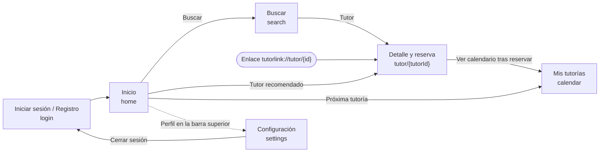

# TutorLink · App de tutorías

App Android para buscar tutores y reservar tutorías, hecha con Jetpack Compose, Material Design 3, Firebase y Room.

## 1. Problema y solución

**Usuario objetivo.** Estudiantes universitarios que necesitan apoyo en un curso y buscan un tutor.

**Problema validado.** Los estudiantes tienen problemas para encontrar de manera rápida y confiable a otros estudiantes
para tutorías. Una de las quejas principales en las entrevistas fue la falta de información al buscar tutores.
La validación se realizó así:

- **Entrega 1 del equipo cliente:** problem statement, user persona y al menos dos entrevistas con citas textuales,
  evaluados como *Cumple* en la revisión de la Fase 2.
- **Comparación con Knack y Penji (Fase 2):** se adoptaron los perfiles de tutor con sus materias, la búsqueda por curso
  y la reserva; se evitó depender de que la universidad administre el servicio.
- [Task test con Anna Bran](docs/entrega-4/task-test.md) (28/10/2026): encontró un tutor, reservó y localizó la reserva
  en el calendario sin ayuda.

**Propuesta de valor.** Nuestra app facilita encontrar y contactar tutores para los estudiantes que necesiten apoyo, a
diferencia de otras plataformas que no priorizan dar tutorías con tutores de su propia comunidad universitaria.
TutorLink muestra los tutores por curso, con su perfil, tarifa y calificación, y permite reservar una tutoría en pocos
pasos. Las sesiones próximas y completadas quedan en un calendario que funciona incluso sin conexión.

## 2. Cómo ejecutar

| Requisito | Versión |
|---|---|
| Android Studio | **2026.1.3** (build `AI-261.26222.65.2613.15948027`), con su JDK incluido (JetBrains Runtime 25) |
| `minSdk` | **36** (Android 16). `targetSdk` y `compileSdk`: 37 |
| Android Gradle Plugin / Gradle | 9.4.0 / 9.6.0 (wrapper incluido) |
| Dispositivo | Emulador o teléfono con Android 16 o superior y conexión a internet |

Las versiones están definidas en [`app/build.gradle.kts`](app/build.gradle.kts) y
[`gradle/libs.versions.toml`](gradle/libs.versions.toml).

### Pasos

1. **Clonar** la rama de la entrega:

   ```bash
   git clone -b entrega-final https://github.com/Lester-Rodrigo/Proyecto_App_Tutorias.git
   ```

2. **Abrir** en Android Studio: *File › Open* y elegir la carpeta `Proyecto_App_Tutorias`.
3. **Sincronizar**: esperar a que termine *Gradle Sync*. Si Android Studio pide un JDK, elegir el incluido en
   *Settings › Build, Execution, Deployment › Build Tools › Gradle › Gradle JDK* (`jbr-25`). Si no encuentra el SDK,
   crear `local.properties` con `sdk.dir=<ruta del Android SDK>`.
4. **Ejecutar**: seleccionar la configuración `app` y un emulador o teléfono, y pulsar **Run ▶**.
5. En la pantalla de inicio de sesión, cambiar a **registro**, crear una cuenta con nombre, correo y contraseña, y
   entrar.

### Configuración de Firebase

El repositorio ya incluye [`app/google-services.json`](app/google-services.json), conectado al proyecto de Firebase
`app-tutorias-5710d`. Ese proyecto tiene habilitados Authentication con correo y contraseña, Cloud Firestore con el
catálogo cargado (`subjects` y `tutors`) y Crashlytics. **No hay que configurar nada para ejecutar la app.**

Para usar un proyecto de Firebase propio:

1. Crear el proyecto en la [consola de Firebase](https://console.firebase.google.com/) y registrar una app Android con
   el paquete **`com.example.app_tutorias`**.
2. Descargar su `google-services.json` y reemplazar `app/google-services.json`.
3. Habilitar *Authentication › Email/Password* y crear una base de datos de *Cloud Firestore*.
4. Cargar las colecciones `subjects` y `tutors` y publicar las reglas, siguiendo [docs/firestore.md](docs/firestore.md).

## 3. Flujo de usuario



La barra inferior navega entre **Inicio**, **Buscar**, **Calendario** y **Configuración**. Desde el detalle, *Volver*
regresa a la pantalla anterior. Las rutas están en
[`Destination.kt`](app/src/main/java/com/example/tutorlink/navigation/Destination.kt) y la navegación en
[`NavHost.kt`](app/src/main/java/com/example/tutorlink/navigation/NavHost.kt).

## 4. Arquitectura

```text
UI (Compose)        →  ViewModel             →  Repository                                  →  Firestore / Room / DataStore
──────────────────────────────────────────────────────────────────────────────────────────────────────────────────────────
LoginScreen         →  AuthViewModel         →  AuthRepositoryImpl                          →  AuthRemoteDataSource (Firebase Auth)
                                                                                               UserRemoteDataSource (Firestore: users)
HomeScreen          →  HomeViewModel         →  TutorLinkRepositoryImpl                     →  CatalogRepositoryImpl → CatalogRemoteDataSource (Firestore: subjects, tutors)
SearchScreen        →  SearchViewModel       →  TutorLinkRepositoryImpl                        UserRepositoryImpl    → UserRemoteDataSource (Firestore: users)
                                                SearchHistoryRepositoryImpl                    SessionRepositoryImpl → SessionRemoteDataSource (Firestore: sessions)
CalendarScreen      →  CalendarViewModel     →  TutorLinkRepositoryImpl                     →  SearchHistoryDao (Room: search_history)
TutorDetailScreen   →  TutorDetailViewModel  →  TutorLinkRepositoryImpl, SessionRepositoryImpl
SettingsScreen      →  ThemeViewModel        →  ThemeRepositoryImpl                         →  ThemeDataStore (DataStore Preferences)
```

- **UI:** [`ui/screens/`](app/src/main/java/com/example/tutorlink/ui/screens).
- **ViewModel:** uno por pantalla, en [`ui/`](app/src/main/java/com/example/tutorlink/ui). Reciben contratos de
  repositorio por constructor y exponen `StateFlow` de solo lectura.
- **Repository:** contratos en [`domain/repository/`](app/src/main/java/com/example/tutorlink/domain/repository) e
  implementaciones en [`data/repository/`](app/src/main/java/com/example/tutorlink/data/repository).
  `TutorLinkRepositoryImpl` comparte entre pantallas las lecturas de catálogo, perfil y sesiones.
- **Datos:** Firestore en [`data/remote/`](app/src/main/java/com/example/tutorlink/data/remote), Room en
  [`data/local/room/`](app/src/main/java/com/example/tutorlink/data/local/room) y DataStore en
  [`data/local/datastore/`](app/src/main/java/com/example/tutorlink/data/local/datastore).
- **Inyección:** manual en [`AppContainer.kt`](app/src/main/java/com/example/tutorlink/di/AppContainer.kt).

## 5. Mínimos técnicos

| ID | Qué debe cumplir | Dónde se cumple |
|---|---|---|
| M1 | Pantallas del flujo principal y tema propio (colores y tipografía) | [`TutorLinkTheme`](app/src/main/java/com/example/tutorlink/ui/theme/Theme.kt#L46), [`Color.kt`](app/src/main/java/com/example/tutorlink/ui/theme/Color.kt), [`TutorLinkTypography`](app/src/main/java/com/example/tutorlink/ui/theme/Type.kt#L37); aplicado en [`MainActivity.kt`](app/src/main/java/com/example/tutorlink/MainActivity.kt#L27); pantallas en [`ui/screens/`](app/src/main/java/com/example/tutorlink/ui/screens) |
| M2 | Navigation Compose, pantalla con argumento y Atrás | [`navArgument("tutorId")`](app/src/main/java/com/example/tutorlink/navigation/NavHost.kt#L187), [`popBackStack()`](app/src/main/java/com/example/tutorlink/navigation/NavHost.kt#L206), rutas en [`Destination.kt`](app/src/main/java/com/example/tutorlink/navigation/Destination.kt) |
| M3 | LazyColumn con `key` | [`items(filteredTutors, key = { it.id })`](app/src/main/java/com/example/tutorlink/ui/screens/SearchScreen.kt#L161), [`items(visibleSessions, key = { it.id })`](app/src/main/java/com/example/tutorlink/ui/screens/CalendarScreen.kt#L93) |
| M4 | Formulario con 3+ campos validados en tiempo real, errores junto al campo y botón condicionado | [`validateBookingForm`](app/src/main/java/com/example/tutorlink/data/BookingValidation.kt#L40), [`onBookingTopicChanged…`](app/src/main/java/com/example/tutorlink/ui/detail/TutorDetailViewModel.kt#L71), [`error junto al campo`](app/src/main/java/com/example/tutorlink/ui/screens/TutorDetailScreen.kt#L158), [`enabled = uiState.canSubmit`](app/src/main/java/com/example/tutorlink/ui/screens/TutorDetailScreen.kt#L231) |
| M5 | MVVM con estado inmutable en StateFlow que sobrevive a la rotación; Composables con estado y callbacks | [`HomeViewModel.uiState`](app/src/main/java/com/example/tutorlink/ui/home/HomeViewModel.kt#L17), [`SearchViewModel.uiState`](app/src/main/java/com/example/tutorlink/ui/search/SearchViewModel.kt#L24), [`CalendarViewModel.uiState`](app/src/main/java/com/example/tutorlink/ui/calendar/CalendarViewModel.kt#L19), [`TutorDetailViewModel.uiState`](app/src/main/java/com/example/tutorlink/ui/detail/TutorDetailViewModel.kt#L32), [`SearchScreen(uiState, on…)`](app/src/main/java/com/example/tutorlink/ui/screens/SearchScreen.kt#L49); prueba [`reusing the owner retains…`](app/src/test/java/com/example/tutorlink/FirestoreFlowViewModelTest.kt#L317) |
| M6 | Ningún Composable ni ViewModel importa Firebase ni Room | Los ViewModels solo importan contratos de [`domain/repository/`](app/src/main/java/com/example/tutorlink/domain/repository); Firebase y Room solo aparecen en [`data/`](app/src/main/java/com/example/tutorlink/data) y [`AppContainer.kt`](app/src/main/java/com/example/tutorlink/di/AppContainer.kt) |
| M7 | ViewModel recibe el Repository por constructor | [`ScreenViewModelFactory`](app/src/main/java/com/example/tutorlink/ui/ScreenViewModelFactory.kt#L20), [`AuthViewModelFactory.kt`](app/src/main/java/com/example/tutorlink/ui/login/AuthViewModelFactory.kt), [`ThemeViewModelFactory.kt`](app/src/main/java/com/example/tutorlink/ui/settings/ThemeViewModelFactory.kt) |
| M8 | Operaciones `suspend` o `Flow` lanzadas desde `viewModelScope` | [`SessionRepository`](app/src/main/java/com/example/tutorlink/domain/repository/SessionRepository.kt#L9), [`CatalogRepository`](app/src/main/java/com/example/tutorlink/domain/repository/CatalogRepository.kt#L8), [`viewModelScope.launch`](app/src/main/java/com/example/tutorlink/ui/detail/TutorDetailViewModel.kt#L108) |
| M9 | Firestore: lee la colección principal, escribe desde una acción del usuario y devuelve data class de dominio | Lectura: [`observeTutors`](app/src/main/java/com/example/tutorlink/data/remote/firestore/CatalogRemoteDataSource.kt#L11); escritura al reservar: [`createSession`](app/src/main/java/com/example/tutorlink/data/remote/firestore/SessionRemoteDataSource.kt#L56); dominio: [`CatalogRepositoryImpl.observeTutors`](app/src/main/java/com/example/tutorlink/data/repository/CatalogRepositoryImpl.kt#L15) → [`data class Tutor`](app/src/main/java/com/example/tutorlink/domain/model/Tutor.kt#L10) |
| M10 | Estados de carga, error y vacío; sin conexión no se cierra ni carga indefinidamente | [`DataStatus`](app/src/main/java/com/example/tutorlink/ui/components/DataStatus.kt#L18), [`observeWithDeadline (12 s)`](app/src/main/java/com/example/tutorlink/data/repository/TutorLinkRepositoryImpl.kt#L111), [`withTimeoutOrNull (10 s)`](app/src/main/java/com/example/tutorlink/data/remote/firestore/SessionRemoteDataSource.kt#L76) |
| M11 | Room: Entity, DAO y Database; un dato sobrevive al cierre | [`SearchHistoryEntity.kt`](app/src/main/java/com/example/tutorlink/data/local/room/SearchHistoryEntity.kt), [`SearchHistoryDao.kt`](app/src/main/java/com/example/tutorlink/data/local/room/SearchHistoryDao.kt), [`TutorLinkDatabase.kt`](app/src/main/java/com/example/tutorlink/data/local/room/TutorLinkDatabase.kt), [`Room.databaseBuilder`](app/src/main/java/com/example/tutorlink/di/AppContainer.kt#L69); [evidencia tras cierre completo](docs/entrega-4/evidencias/10-historial-tras-cierre-completo-sin-red.png) |
| M12 | Convenciones del curso | [docs/entrega-4/convenciones.md](docs/entrega-4/convenciones.md), [correcciones de la entrega final](docs/ENTREGA_FINAL_CORRECCIONES.md) |
| M13 | Crashlytics registra como no fatales los errores del Repository | [`recordNonFatal`](app/src/main/java/com/example/tutorlink/data/reporting/CrashlyticsErrorReporter.kt#L7), [`ErrorReporter.kt`](app/src/main/java/com/example/tutorlink/domain/reporting/ErrorReporter.kt), uso en [`SessionRepositoryImpl`](app/src/main/java/com/example/tutorlink/data/repository/SessionRepositoryImpl.kt#L38) |
| M14 ★ | Build en Firebase App Distribution con notas de versión e instalado por 2+ testers externos | Versión final **1.2 (3)** firmada con la clave original y distribuida a 4 testers con [notas de versión](docs/entrega-final/notas-version-1.2.txt). [Captura de publicación](docs/entrega-final/evidencias/app-distribution-1.2-publicada.jpg) y [verificación](docs/entrega-final/distribucion.md). Al publicar registra **0 descargas**: las dos descargas externas siguen pendientes para completar M14. |
| M15 ★ | Sin bugs críticos en el flujo principal | Pruebas: [`FirestoreFlowViewModelTest.kt`](app/src/test/java/com/example/tutorlink/FirestoreFlowViewModelTest.kt), [`BookingValidatorTest.kt`](app/src/test/java/com/example/tutorlink/BookingValidatorTest.kt); [evidencias y video del flujo completo](docs/entrega-4/evidencias/README.md) |

## 6. Alcance

Historias Must de la Entrega 2 y su estado en la Entrega 4. El detalle de las funciones dentro y fuera del alcance
congelado está en [docs/entrega-4/alcance.md](docs/entrega-4/alcance.md).

### Dentro

| ID | Historia | Criterio de aceptación | ¿Completada? | Dónde se cumple |
|---|---|---|---|---|
| F1 | Como estudiante que desea buscar un tutor, quiero ver el perfil completo del tutor con su precio, horario y los cursos que domina, para tener toda la información antes de contactarlo. | Al abrir el perfil del tutor, el sistema muestra el precio, el horario disponible y las materias que domina. | ✅ Sí. El horario se muestra cuando el tutor lo tiene publicado en Firestore; si no, la app avisa que no hay horarios publicados. | [`TutorDetailScreen.kt`](app/src/main/java/com/example/tutorlink/ui/screens/TutorDetailScreen.kt), [`DomainUiMappers.kt`](app/src/main/java/com/example/tutorlink/ui/DomainUiMappers.kt) (`Tutor.toUiModel`) |
| F2 | Como estudiante que desea buscar un tutor, quiero buscar tutores por el curso que necesito, para encontrar rápido a alguien que pueda ayudarme. | Al buscar por un curso específico, el sistema muestra únicamente los tutores que tienen registrado ese curso. | ✅ Sí | [`TutorFilter.kt`](app/src/main/java/com/example/tutorlink/data/TutorFilter.kt) (`filterTutors`), [`SearchViewModel.kt`](app/src/main/java/com/example/tutorlink/ui/search/SearchViewModel.kt), [`TutorFilterTest.kt`](app/src/test/java/com/example/tutorlink/TutorFilterTest.kt) |

### Fuera

| ID | Historia | Motivo |
|---|---|---|
| F7 | Como estudiante que ya eligió al tutor, quiero ser redirigido directamente al WhatsApp del tutor, para contactarlo rápido. | No se implementó: la app no guarda el número de teléfono del tutor ni tiene botón de contacto. |

## 7. Referencias y uso de IA

### Documentación oficial y material consultado

- [Jetpack Compose](https://developer.android.com/develop/ui/compose/documentation) y
  [Material Design 3 en Compose](https://developer.android.com/develop/ui/compose/designsystems/material3)
- [Navigation Compose](https://developer.android.com/develop/ui/compose/navigation) y
  [deep links](https://developer.android.com/guide/navigation/design/deep-link)
- [Guía de arquitectura de apps](https://developer.android.com/topic/architecture),
  [ViewModel](https://developer.android.com/topic/libraries/architecture/viewmodel) y
  [StateFlow](https://developer.android.com/kotlin/flow/stateflow-and-sharedflow)
- [Room](https://developer.android.com/training/data-storage/room) y
  [DataStore](https://developer.android.com/topic/libraries/architecture/datastore)
- [Firebase Authentication](https://firebase.google.com/docs/auth/android/start),
  [Cloud Firestore](https://firebase.google.com/docs/firestore),
  [caché sin conexión](https://firebase.google.com/docs/firestore/manage-data/enable-offline),
  [metadatos de escrituras pendientes](https://firebase.google.com/docs/firestore/query-data/listen),
  [Crashlytics](https://firebase.google.com/docs/crashlytics/get-started?platform=android) y
  [App Distribution](https://firebase.google.com/docs/app-distribution/android/distribute-console)
- Material de clase: [Competitive Usability Evaluations](https://www.nngroup.com/articles/competitive-usability-evaluations/)
  (Nielsen Norman Group), [MoSCoW](https://www.agilebusiness.org/resource/what-is-moscow-prioritization/)
  (Agile Business Consortium), [User stories](https://www.atlassian.com/agile/project-management/user-stories) y
  [Acceptance criteria](https://www.atlassian.com/work-management/project-management/acceptance-criteria) (Atlassian)
- Documentación del equipo: [docs/firestore.md](docs/firestore.md),
  [informe de testeo](docs/testeo/informe-final.md),
  [evidencias de la Entrega 4](docs/entrega-4/evidencias/README.md) y
  [correcciones de la entrega final](docs/ENTREGA_FINAL_CORRECCIONES.md)

### Uso de IA


| Para qué se utilizó | Cómo se verificó |
|---|---|
| Informe de testeo, guion de la sesión y diagrama del flujo (Entrega 3) | El equipo confirmó en la app los hallazgos, como el problema del campo Hora ([sección 9 del informe](docs/testeo/informe-final.md#9-uso-de-inteligencia-artificial)) |
| Parte del código del historial de búsquedas y documentación de la Entrega 4 | El equipo revisó los cambios, compiló, ejecutó las pruebas unitarias y grabó las evidencias en el emulador con Firebase real ([evidencias](docs/entrega-4/evidencias/README.md)) |
| Auditoría y corrección de las observaciones de la entrega final (⏳ confirmar la herramienta utilizada) | Compilación exitosa y 28 pruebas unitarias aprobadas, con los commits trazados en [ENTREGA_FINAL_CORRECCIONES.md](docs/ENTREGA_FINAL_CORRECCIONES.md) |
| Redacción de este README | El equipo comprobó que las versiones, rutas, clases y enlaces coinciden con el código de la rama `entrega-final` |
| Preparación de 1.2 (3), firma privada, script de build y documentación de distribución con OpenAI Codex | 28 pruebas unitarias aprobadas; build debug y release, lint y firma verificados; publicación en Firebase confirmada. Evidencias y límites en [distribucion.md](docs/entrega-final/distribucion.md) |
