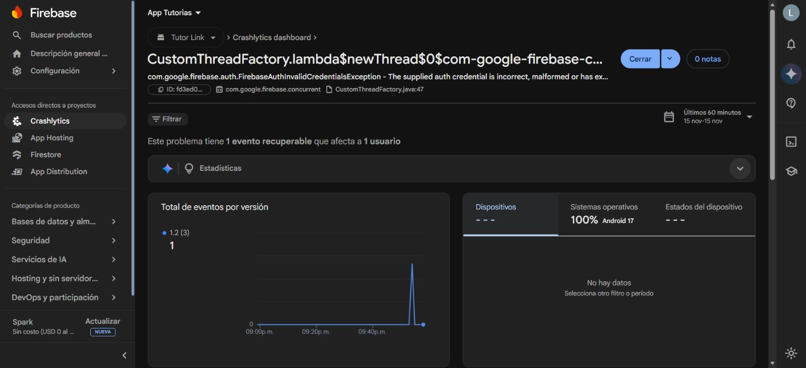

# Evidencia no fatal del build distribuido

**Build actual: 1.3 (4).** [Evento no fatal, captura y pruebas de la actualización del cross-review](release-1.3.md#publicación-y-monitoreo). La evidencia 1.2 de este documento se conserva como histórica.

## Evento real

- Aplicación: `com.example.app_tutorias`.
- Build: **1.2 (3)**, APK firmado distribuido en Firebase.
- Fecha del evento en consola: **15 de noviembre de 2026, 21:54:44 (Guatemala)**.
- Tipo: **error recuperable / Non-fatal Exception**.
- Excepción: `com.google.firebase.auth.FirebaseAuthInvalidCredentialsException`.
- Operación registrada: `auth.signIn`.
- Problema en Firebase: `fd3ed0c5417b1f4d09fcfcfdddb1a043`.
- [Abrir el evento en Crashlytics](https://console.firebase.google.com/u/1/project/app-tutorias-5710d/crashlytics/app/android:com.example.app_tutorias/issues/fd3ed0c5417b1f4d09fcfcfdddb1a043?time=60m&sessionEventKey=6AFA7E7101870001104A6257624B1557_2287058420735886267) (requiere acceso al proyecto; ampliar el período cuando transcurra una hora).

## Qué ocurrió y qué decidimos

**Esperado:** se intentó iniciar sesión con credenciales deliberadamente inválidas de una cuenta de demostración no registrada. Firebase rechazó el acceso. `AuthRepositoryImpl.signIn()` capturó la excepción y llamó a `ErrorReporter.recordNonFatal()` con `auth.signIn`; `CrashlyticsErrorReporter` la registró mediante `recordException()`.

La excepción es una respuesta esperada ante credenciales incorrectas, no un cierre inesperado ni un defecto que requiera un commit de corrección. No se cambió el código de producción ni se añadió un botón de fallo a la app distribuida.

Se cerró y reabrió la aplicación para enviar el reporte pendiente. La consola muestra **1 evento recuperable de 1.2 (3)** en la última hora. El mismo problema agrupa eventos anteriores de 1.0; la captura filtra la última hora para identificar el evento nuevo.

## Trazabilidad

- [Prueba optativa de integración](../../app/src/androidTest/java/com/example/tutorlink/EntregaFinalEvidenceTest.kt): `captureNonFatalFromRepository`, ejecutada sobre el APK release intacto mediante instrumentación separada firmada con el mismo certificado.
- [Resultado: OK (1 test)](evidencias/prueba-no-fatal.log).
- [Excepción, operación y fecha observadas](evidencias/dispositivo/non-fatal.txt).
- [Registro de envío de Crashlytics](evidencias/envio-crashlytics.log).
- [Comparación del SHA-256 del APK instalado con el publicado](evidencias/apk-instalado-verificado.txt).
- [Implementación de captura](../../app/src/main/java/com/example/tutorlink/data/repository/AuthRepositoryImpl.kt) y [reportador](../../app/src/main/java/com/example/tutorlink/data/reporting/CrashlyticsErrorReporter.kt).

Los archivos de credenciales de firma y de la cuenta de demostración permanecen fuera de Git. Se utilizó Firebase real; no se simuló el evento ni se editó la captura.

Referencia: [Firebase: personalizar informes y registrar errores no fatales](https://firebase.google.com/docs/crashlytics/android/customize-crash-reports).
