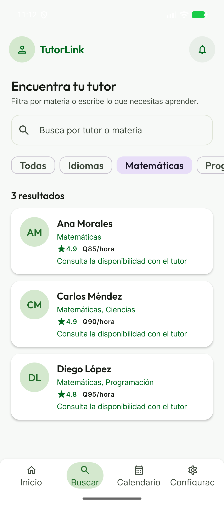
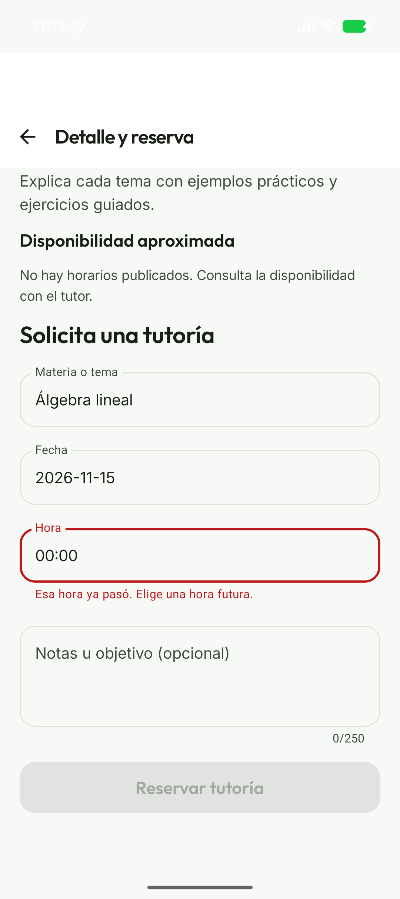

# Cross-review recibido: respuesta de TutorLink

[Hoja original entregada por el usuario](Hoja_CrossReview.pdf), conservada sin modificar. Se revisaron visualmente las cuatro páginas: las respuestas completadas son anotaciones que no aparecen en la extracción de texto del PDF.

La hoja se identifica con **RutaU** y los nombres **Sergio Tepaz, Carlos Altan y Jordi Cardona**. Sus hallazgos hacen referencia al flujo y archivos de TutorLink; se documentan aquí como la revisión recibida, sin confundir esos nombres con los integrantes de TutorLink.

## Hallazgo 1: reserva para una hora pasada de hoy

- **Prueba/pantalla:** #4, Detalle y reserva.
- **Pasos:** abrir un tutor; escribir un tema válido; seleccionar la fecha de hoy; escribir una hora que ya pasó.
- **Esperado:** informar que la hora pasó y mantener la reserva deshabilitada.
- **Obtenido en la versión revisada:** se validaba la fecha pero no la hora del día; podía guardarse una reserva pasada como `UPCOMING`.
- **Severidad recibida:** menor.
- **Respuesta:** válido y corregido. `validateBookingForm` compara la hora con la actual cuando la fecha es hoy; rechaza horas anteriores y el minuto actual. El error aparece junto a Hora y deshabilita el envío. El ViewModel vuelve a validar al pulsar reservar, por lo que también rechaza un formulario cuya hora quedó atrás mientras estaba abierto.
- **Commit:** [`9560cbc`](https://github.com/Lester-Rodrigo/Proyecto_App_Tutorias/commit/9560cbcaa7b880cc3a919f0dcf756e23475c5e6f).
- **Pruebas de regresión:** hora anterior y minuto actual rechazados; minuto futuro de hoy y hora temprana de mañana admitidos; formato inválido sigue rechazado. Se inyecta la hora en la prueba para evitar resultados dependientes del reloj del equipo.
- **Código:** [BookingValidation.kt](../../../app/src/main/java/com/example/tutorlink/data/BookingValidation.kt), [mensaje de campo](../../../app/src/main/java/com/example/tutorlink/ui/screens/TutorDetailScreen.kt), [pruebas](../../../app/src/test/java/com/example/tutorlink/BookingValidationTest.kt).

## Hallazgo 2: materias de Inicio no filtran la búsqueda

- **Prueba/pantalla:** #1, Inicio → Buscar.
- **Pasos:** pulsar una materia en «Materias populares».
- **Esperado:** abrir Buscar con esa materia seleccionada y mostrar sus tutores.
- **Obtenido en la versión revisada:** todas las materias llamaban al mismo callback de búsqueda sin transmitir su identificador.
- **Severidad recibida:** menor.
- **Respuesta:** válido y corregido. `HomeScreen` emite el ID con `onCategoryClick`; el host llama a `SearchViewModel.onHomeCategorySelected` y abre Buscar. El ViewModel aplica la categoría y limpia un texto anterior para no ocultar los tutores correspondientes. Repetir la misma categoría desde Inicio mantiene el filtro; los chips internos de Buscar conservan su comportamiento de activar/desactivar.
- **Commit:** [`9560cbc`](https://github.com/Lester-Rodrigo/Proyecto_App_Tutorias/commit/9560cbcaa7b880cc3a919f0dcf756e23475c5e6f).
- **Prueba de regresión:** seleccionar Matemáticas después de buscar en otra materia limpia el texto, muestra únicamente tutores de Matemáticas y mantiene el filtro al volver a pulsarla.
- **Código:** [HomeScreen.kt](../../../app/src/main/java/com/example/tutorlink/ui/screens/HomeScreen.kt), [NavHost.kt](../../../app/src/main/java/com/example/tutorlink/navigation/NavHost.kt), [SearchViewModel.kt](../../../app/src/main/java/com/example/tutorlink/ui/search/SearchViewModel.kt), [prueba](../../../app/src/test/java/com/example/tutorlink/FirestoreFlowViewModelTest.kt).

## Hallazgo 3: horarios añadidos sin provenir del tutor

- **Prueba/pantalla:** #1, Detalle del tutor.
- **Pasos:** abrir un tutor y revisar «Disponibilidad aproximada».
- **Esperado:** mostrar solo horarios reales o indicar que no hay disponibilidad estructurada.
- **Obtenido en la versión revisada:** se añadían «viernes 11:00 a. m.» y «sábado 9:00 a. m.» sin provenir de Firestore.
- **Severidad recibida:** sugerencia.
- **Respuesta:** ya corregido antes de recibir esta hoja, en [`6f44909`](https://github.com/Lester-Rodrigo/Proyecto_App_Tutorias/commit/6f449094cfbb02c4c055d14cc236391f1585775c). No se descarta el hallazgo original ni se atribuye una corrección nueva. `Tutor.toUiModel` obtiene los horarios exclusivamente de `availability`; el detalle los recorre y, cuando no hay horarios, indica que no se han publicado. Los horarios señalados ya no están en el código activo.
- **Prueba existente:** `detail availability follows repository snapshots without fabricated times`, que verifica cambios de disponibilidad y el caso sin horarios.
- **Código:** [DomainUiMappers.kt](../../../app/src/main/java/com/example/tutorlink/ui/DomainUiMappers.kt), [TutorDetailScreen.kt](../../../app/src/main/java/com/example/tutorlink/ui/screens/TutorDetailScreen.kt), [prueba](../../../app/src/test/java/com/example/tutorlink/FirestoreFlowViewModelTest.kt).

## Lo que esta hoja no acredita

Este documento responde los tres hallazgos recibidos. No contiene tres hallazgos que TutorLink haya entregado sobre otra app. Esa segunda parte del cross-review sigue pendiente de aportar por el equipo y no se inventó.

Las correcciones están publicadas en **1.3 (4)**. [Build firmado, 31 pruebas unitarias, 3 pruebas instrumentadas, capturas, distribución y monitoreo](../release-1.3.md). Los dos hallazgos se verificaron también en pantalla; el tercero conserva su prueba de disponibilidad real. La evidencia de 1.2 (3) permanece como histórica.

