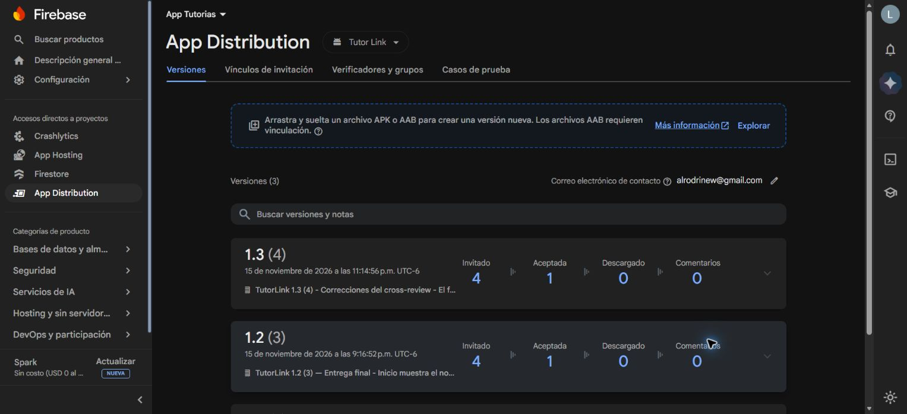
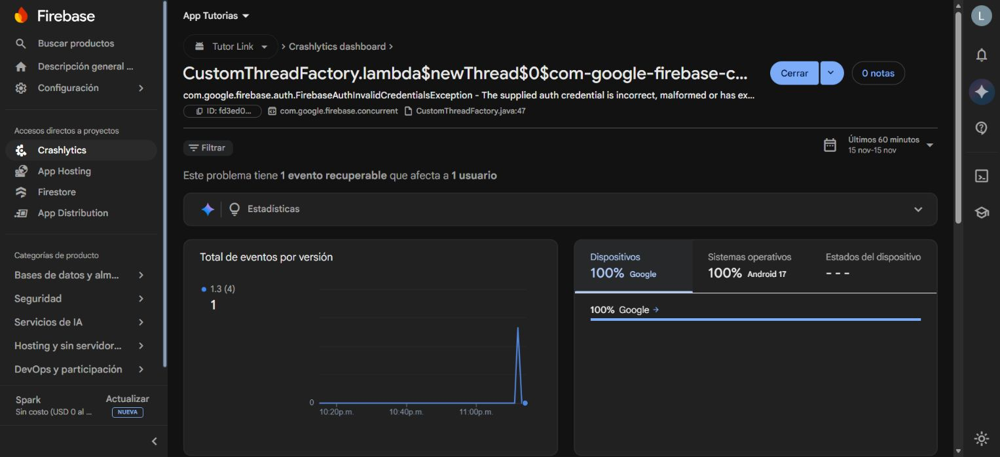

# TutorLink 1.3 (4): actualización del cross-review

Correcciones de código: [`9560cbc`](https://github.com/Lester-Rodrigo/Proyecto_App_Tutorias/commit/9560cbcaa7b880cc3a919f0dcf756e23475c5e6f).

- Bloqueo y mensaje de error para una hora pasada o el minuto actual cuando la reserva es para hoy.
- Materias populares de Inicio conectadas al filtro real de Buscar, con limpieza de una búsqueda anterior y selección estable al repetir la materia.
- Disponibilidad real: corrección anterior conservada y verificada mediante las pruebas existentes, sin horarios añadidos.

[Hoja original y respuesta a los tres hallazgos](cross-review/README.md). [Notas de versión](notas-version-1.3.txt).

## Verificación de compilación

Comando: `testDebugUnitTest assembleDebugAndroidTest assembleRelease lintDebug lintRelease`, fuera de OneDrive con JDK 25.

**BUILD SUCCESSFUL in 1m 49s**, 125 tareas (45 ejecutadas, 80 actualizadas).

- **31 pruebas unitarias**, sin fallos, errores ni omisiones: BookingValidationTest (7), BookingValidatorTest (4), FirestoreFlowViewModelTest (17), TutorFilterTest (3).
- Lint debug: 0 errores, 12 advertencias. Lint release: 0 errores, 11 advertencias.
- Firma verificada con el certificado original: `97742386bc611d09b7ab4f3a0902fcd9defe239ed6ac4567e76eab13597fd3db`.
- SHA-256 del APK: `be1a237aa66524ea83b9c1dfb85107bbe244b6c674ecff92aea83570225e11fa`.
- APK local: `app/build/outputs/final/TutorLink-1.3-4.apk`.

[Log de compilación](evidencias/1.3/validacion-gradle.log), [metadatos](evidencias/1.3/output-metadata.json), [firma](evidencias/1.3/firma-release.txt), [JUnit y lint](evidencias/1.3/).

## Pruebas reales en emulador Android 17

- [Cross-review y evento no fatal: OK (2 tests)](evidencias/1.3/prueba-cross-review-y-no-fatal.log).
- [Flujo principal: OK (1 test)](evidencias/1.3/prueba-demo.log).
- [Matemáticas seleccionada desde Inicio, con tres resultados](evidencias/1.3/dispositivo/07-filtro-desde-inicio.png).
- [Hora pasada con mensaje y botón deshabilitado](evidencias/1.3/dispositivo/08-hora-pasada-bloqueada.png).
- La actualización se instaló sobre 1.2 con `adb install -r`, con la misma firma y sin borrar datos. La cuenta de demostración siguió autenticada.
- El APK de producción no se modificó para estas pruebas; la instrumentación se compiló y firmó por separado.

## Publicación y monitoreo

**1.3 (4) distribuida** a los cuatro testers existentes en Firebase App Distribution, con [notas de versión](notas-version-1.3.txt). Fecha de carga: **15 de noviembre de 2026 a las 23:14:56 (Guatemala)**.

Estado al verificar: **4 invitados, 1 aceptación y 0 descargas**. Las dos descargas externas requeridas siguen pendientes; la prueba del equipo en el emulador no cuenta como descarga externa.

Crashlytics recibió **1 evento recuperable de 1.3 (4)**, a las **23:12:43 (Guatemala)** del mismo día: `FirebaseAuthInvalidCredentialsException` de la operación `auth.signIn`.

**Decisión: esperado.** Se intentó iniciar sesión con credenciales deliberadamente inválidas; el repositorio registró el error sin cerrar la app. No requiere un commit de corrección. Se cerró y reabrió la app para enviar el reporte pendiente.

[Excepción registrada](evidencias/1.3/dispositivo/non-fatal.txt), [envío del reporte](evidencias/1.3/envio-crashlytics.log) y [evento en Firebase](https://console.firebase.google.com/u/1/project/app-tutorias-5710d/crashlytics/app/android:com.example.app_tutorias/issues/fd3ed0c5417b1f4d09fcfcfdddb1a043?time=60m&sessionEventKey=6AFA90AB03CB000127ED7A6DF2CA4BC8_2287078517030469744) (requiere acceso; ampliar el período al consultar más tarde).

## Demo actualizada

El [video continuo de respaldo](demo/video-respaldo.mp4) corresponde ahora a **1.3 (4)** y dura **37,93 segundos**, sin cortes ni aceleración. [Metadatos](evidencias/1.3/video-metadata.json). Las [ocho diapositivas PDF](demo/diapositivas-tutorlink.pdf) usan capturas nuevas de esta versión y reflejan las 31 pruebas unitarias.

La evidencia de 1.2 (3) se conserva como histórica en su carpeta original. Las pruebas nuevas verifican los dos hallazgos, el flujo principal y el registro no fatal; no se presenta como repetida toda la matriz manual de rotación, temas y modo avión.
