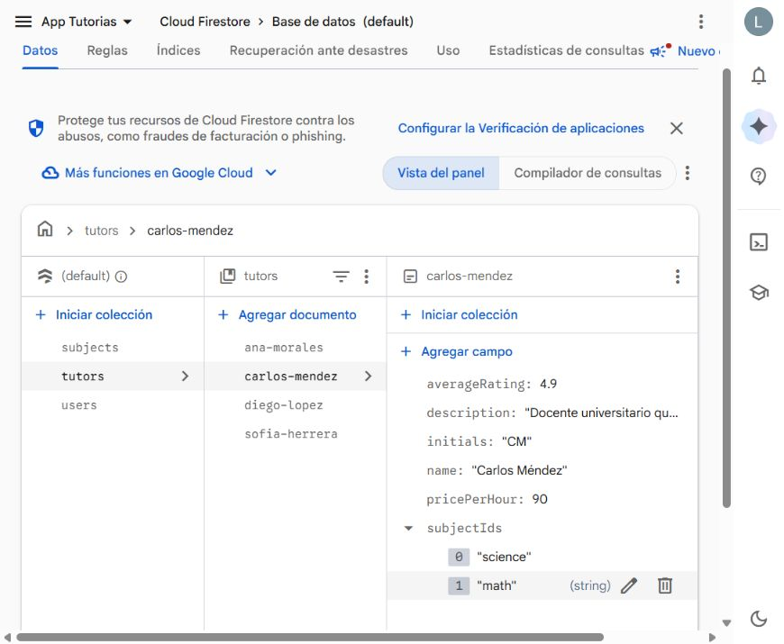

# Conexión de TutorLink con Firestore

La app usa el proyecto indicado en `app/google-services.json` (`app-tutorias-5710d`).
No necesita una cuenta de servicio ni claves de administrador dentro de la app.

## Flujo conectado

- Después de iniciar sesión, `TutorLinkViewModel` observa el catálogo y las sesiones mediante los repositorios inyectados.
- `CatalogRepository` lee `subjects` y `tutors`, y convierte los documentos a modelos de dominio.
- Reservar llama a `SessionRepository.createSession()`. El calendario observa `sessions`, filtrando por `studentId` del usuario autenticado.
- Los datos mock quedan para previews y pruebas; no alimentan el flujo principal.
- Cada reserva usa un identificador estable durante el intento para evitar duplicados por doble pulsación.
- La sesión dura una hora. Se usa la primera materia asociada al tutor como `subjectId`; el tema escrito se guarda en `subjectName`. La fecha/hora se interpreta en la zona del dispositivo y se almacena como Timestamp.

## Configuración que comprobar en la consola

1. Tener Cloud Firestore creado en el proyecto y habilitado el proveedor Email/Password de Firebase Authentication.
2. Tener documentos reales en `subjects` y `tutors`. El campo `subjectIds` de cada tutor debe contener IDs existentes de `subjects`.
3. Comprobar las reglas publicadas: usuarios autenticados pueden leer el catálogo; un estudiante puede crear y leer sus propias sesiones. Las sesiones se consultan con `whereEqualTo("studentId", uid)`. La creación del perfil necesita permiso para escribir su documento en `users`.
4. Iniciar sesión con una cuenta de prueba y reservar. Verificar el documento en `sessions` y su `studentId`, `tutorId`, `subjectId`, `startAt` y `endAt`.

Se revisaron las reglas publicadas en la consola: permiten lectura del catálogo a usuarios autenticados, creación de sesiones con el `studentId` del usuario y consulta de sus propias sesiones. No se modificaron las reglas.

## Catálogo de demostración cargado

Con autorización del usuario se crearon estos ocho documentos en `app-tutorias-5710d` desde la consola:

| Colección | ID | Nombre / relaciones |
|---|---|---|
| `subjects` | `math` | Matemáticas |
| `subjects` | `science` | Ciencias |
| `subjects` | `languages` | Idiomas |
| `subjects` | `programming` | Programación |
| `tutors` | `ana-morales` | Ana Morales → `math` |
| `tutors` | `diego-lopez` | Diego López → `programming`, `math` |
| `tutors` | `sofia-herrera` | Sofía Herrera → `languages` |
| `tutors` | `carlos-mendez` | Carlos Méndez → `science`, `math` |

Son datos de demostración tomados de `MockData.kt`. Se conservaron los nombres, iniciales, descripciones, precios y calificaciones. Las tarifas se guardaron como enteros, las calificaciones como decimales y `subjectIds` como listas de texto. Los horarios relativos de los mocks ("Hoy", "Mañana") no se convirtieron en disponibilidad recurrente: al no haber horarios estructurados, la app muestra su aviso para consultar disponibilidad. `ratingCount` conserva el valor predeterminado del modelo (0).

Se verificó en la consola la existencia de los cuatro documentos de cada colección y sus relaciones al guardarlos. No se insertaron reservas ni se modificaron perfiles de usuario. La reserva real y su sincronización se verificaron el 30/10/2026 desde la app: [evidencias](entrega-4/evidencias/README.md).



### Ejemplo de esquema de catálogo

Documento `subjects/math`:

```json
{
  "name": "Matemáticas",
  "category": "science",
  "emoji": "📐"
}
```

Documento `tutors/tutor-math`:

```json
{
  "name": "Tutor de prueba",
  "initials": "TP",
  "description": "Apoyo en álgebra y cálculo",
  "subjectIds": ["math"],
  "pricePerHour": 100,
  "averageRating": 4.5,
  "ratingCount": 2,
  "availability": [
    { "id": "monday", "dayOfWeek": 1, "startTime": "15:00", "endTime": "18:00" }
  ]
}
```

Los IDs se toman de cada documento. Los valores numéricos y las listas deben conservar sus tipos de Firestore.

## Sin conexión y errores

Firestore mantiene caché local en Android. Una lectura puede devolver datos guardados, o una lista vacía si todavía no hay caché. Si el primer resultado no llega en 12 segundos, la pantalla deja de mostrar carga, ofrece reintentar y mantiene la escucha para recuperarse.

Una reserva espera hasta 10 segundos por confirmación del servidor. Si el servidor no confirma todavía, se muestra **Pendiente de sincronizar**, se detiene el indicador y se bloquea un segundo envío del mismo formulario. Firestore conserva la escritura en su cola; el tiempo de espera no la cancela. El calendario distingue documentos pendientes de los confirmados usando los metadatos del snapshot. Si el servidor rechaza una escritura, se muestra un error.

Guion de verificación. Los puntos ejecutados y las limitaciones están en las [evidencias del 30/10/2026](entrega-4/evidencias/README.md):

1. Recorrer Inicio → Buscar → Tutor → Reservar → Calendario con conexión.
2. Confirmar el documento en la consola de Firebase.
3. Activar modo avión, leer datos previamente cargados e intentar otra reserva.
4. Comprobar que termina la carga y aparece el aviso de sincronización pendiente.
5. Restaurar la red y comprobar que el estado pendiente desaparece y existe un solo documento.
6. Probar permisos denegados y catálogo vacío en un entorno de pruebas.

La persistencia de Firestore no reemplaza el requisito de Room de la Entrega 4; el historial local está conectado a la UI y su persistencia sin red se verificó tras cerrar completamente la app.

Referencias: [caché sin conexión](https://firebase.google.com/docs/firestore/manage-data/enable-offline) y [metadatos de escrituras pendientes](https://firebase.google.com/docs/firestore/query-data/listen).
